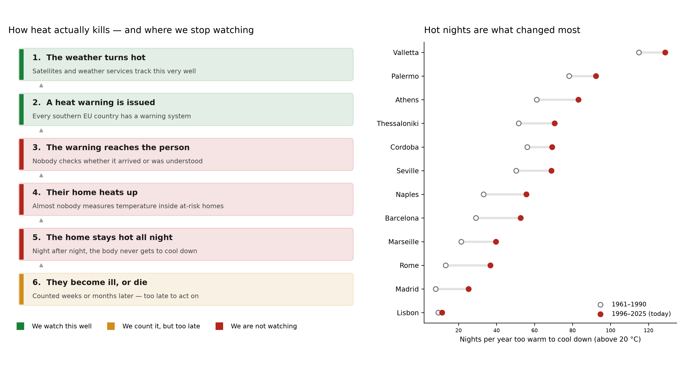
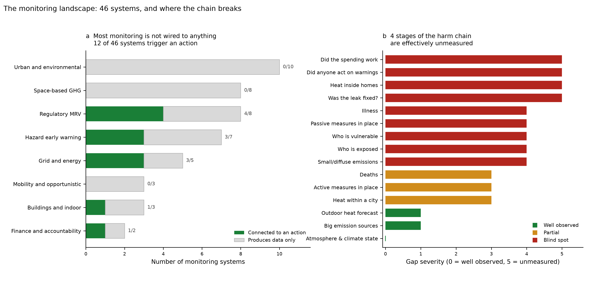
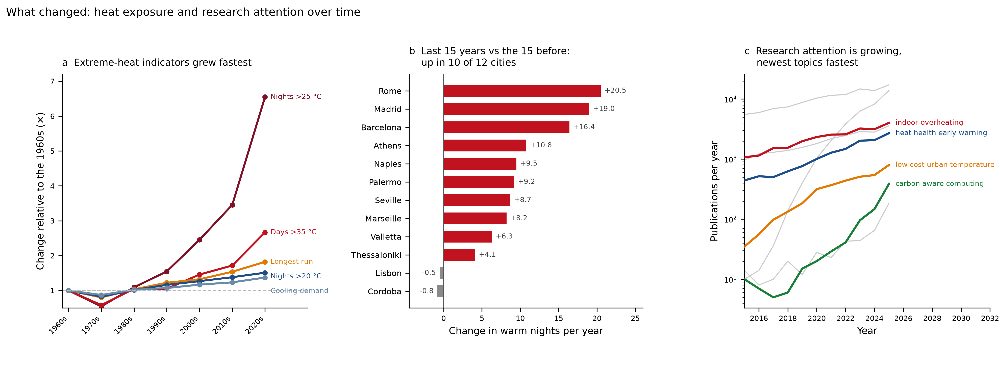
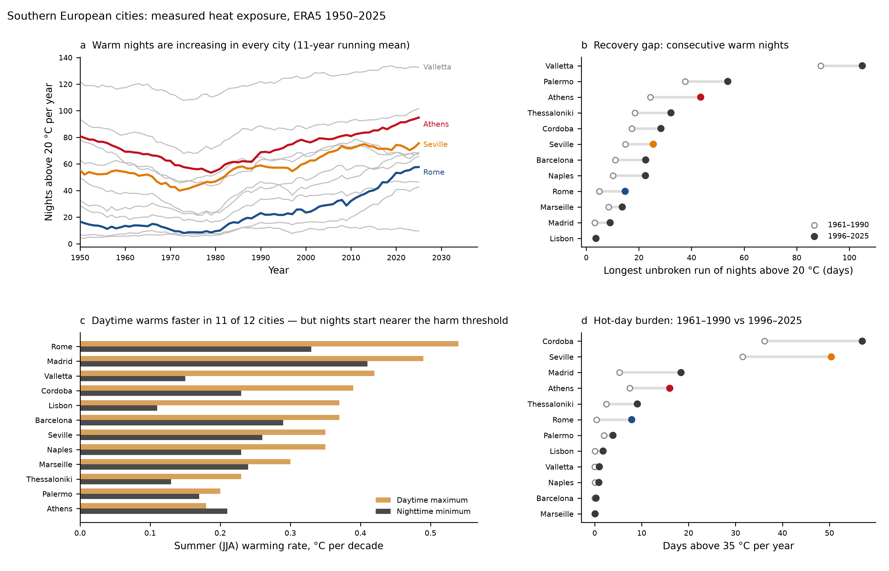
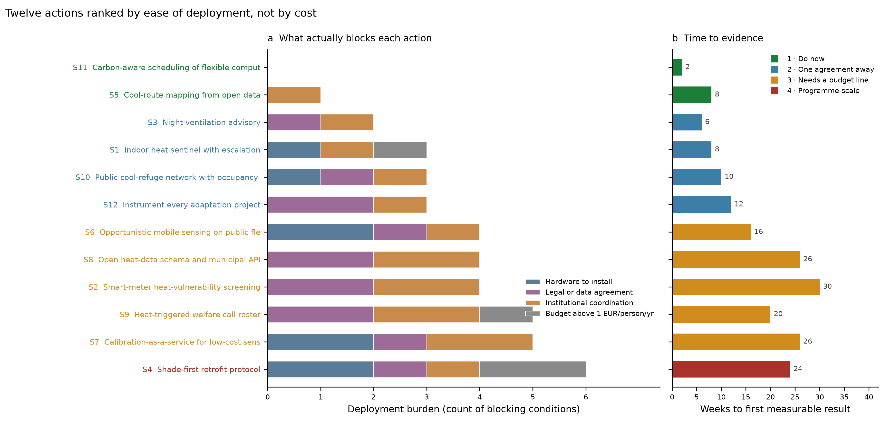
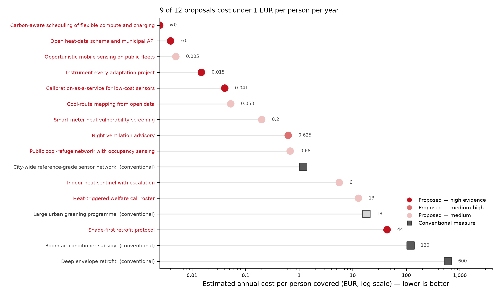

# Where climate monitoring stops watching

**An open analysis of digital climate monitoring: 46 operational systems, 76 years of temperature data for 12 southern European cities, and 12 costed interventions ranked by how hard they are to start.**

[](LICENSE-DATA)
[](LICENSE)
[](https://www.python.org/)

---

## The finding

We are very good at measuring the weather and very bad at checking whether anyone was helped.

Of **46 operational monitoring systems** inventoried across 8 layers — satellite greenhouse-gas observation, regulatory reporting, grid telemetry, urban sensing, hazard warning, buildings, mobility, climate finance — **25 publish open data but only 12 are connected to any actuator** that changes a physical outcome without a human choosing to act. Thirty are connected to nothing at all.

Detection has improved by orders of magnitude in a decade. What has not been built is the machinery that turns a detection into an obligated consequence. This is why most of the interventions proposed here are cheap: the sensing is already paid for.



The three links in the middle of that chain — did the warning arrive, did the home get hot, did it stay hot all night — are where someone could still be helped, and they are exactly the links nobody watches.

---

## What's here

| | |
|---|---|
| **[Dataset website](https://your-deployment-url.pages.dev)** | Search, filter, sort and download every table; data dictionary, citation, release history |
| **[Full report](https://your-deployment-url.pages.dev/report)** | 11 tables, 6 figures, evidence → change → actions → limits |
| **[Plain-language guide](docs/plain_language_guide.md)** | Same findings, no jargon, for a general reader |
| **[Data](data/)** | Every table as CSV, plus a combined `.xlsx` workbook |
| **[Scripts](scripts/)** | Fetch → compute → figures → report, fully reproducible |

---

## Key results

### Four stages of the harm chain are effectively unmeasured



| Stage | What is missing |
|---|---|
| **Response to detection** | We see the methane leak. No public verified record of whether it was repaired. |
| **Indoor heat** | Heat kills indoors, at night, in bedrooms. Nothing measures indoor temperature in at-risk homes at scale. |
| **Behaviour after a warning** | Nobody measures whether anyone acted. Plans cannot improve by guesswork. |
| **Adaptation spending** | Cooling and greening projects are funded without before-and-after measurement at the site. |

### The extremes moved far faster than the averages



ERA5 reanalysis, 12 cities, 1950–2025, 333,108 daily records. From the 1960s to the 2020s:

| Indicator | Change |
|---|---|
| Nights above 20 °C | **1.5×** |
| Days above 35 °C | **2.7×** |
| Longest unbroken warm-night run | **1.8×** |
| **Nights above 25 °C** | **6.5×** |

The deeper into the tail, the steeper the growth — which is why averages understate what people actually experience. (The 2020s row covers 2020–2025 only.)

Comparing 2011–2025 against 1996–2010: warm nights up in **10 of 12** cities (mean +9.3 nights/year), longest warm-night run up in **11 of 12**, hot days up in **11 of 12**. Córdoba and Lisbon are the exceptions on warm nights, both marginally down.

### The recovery gap



The longest unbroken run of nights above 20 °C measures how many consecutive nights pass with no chance for the body to shed accumulated heat.

| City | 1961–1990 | 1996–2025 |
|---|---|---|
| Valletta | 89 nights | **105** |
| Palermo | 38 | **54** |
| Athens | 24 | **44** |
| Rome | 5 | **15** |

**No operational European heat-warning system uses this as a trigger.** They trigger on daytime maximum temperature.

### An honest correction

We expected to find nights warming faster than days. **They are not.** Summer maxima rise at 0.35 °C/decade against 0.23 °C/decade for minima, with daytime faster in **11 of 12** cities. This contradicts the hypothesis the analysis set out to test and is reported as found.

The case for focusing on nights survives on distribution rather than rate: night minima sit close to the threshold at which the body cannot recover, so the slower trend crosses that line on far more nights than the faster daytime trend crosses 40 °C.

---

## Twelve actions, ranked by ease of starting



Ranked by what actually blocks a start — hardware, legal agreements, coordination, budget — not by cost. The ordering is substantially different from a cost ranking: S8, at €0.004 per person per year, is the second-cheapest item in the catalogue and still lands in tier 3, because what it needs is a mandate rather than money.

**Tier 1 — start now, no permission or hardware required**
- **S11 Carbon-aware scheduling** — shift deferrable compute, EV charging, water heating and building pre-cooling to low-carbon grid hours. Nothing is computed less; the same work happens at a different hour. Result in ~2 weeks, ~€0.
- **S5 Cool-route mapping** — shaded walking routes from free satellite thermal imagery and open building footprints.

**Tier 2 — one agreement away**
- **S3 Night-ventilation advisory** · **S1 Indoor heat sentinel with escalation** · **S10 Cool refuges with occupancy counting** · **S12 Instrument every adaptation project**

**Tier 3 — needs a budget line and a named owner**
- **S6 Sensors on public fleets** · **S8 Open heat-data schema** · **S2 Smart-meter vulnerability screening** · **S9 Heat-triggered welfare roster** · **S7 Calibration-as-a-service**

**Tier 4 — programme scale**
- **S4 Shade-first retrofit protocol**



Nine of twelve cost under €1 per person per year, against ~€120 for air-conditioner subsidies and ~€600 for deep envelope retrofit.

---

## Reproducing the analysis

```bash
git clone https://github.com/marizombie/climate-change-data.git
cd climate-heat-monitoring
pip install -r requirements.txt

python scripts/01_fetch_era5.py          # ~15 min, rate-limited; caches per chunk
python scripts/02_compute_indicators.py  # seconds
python scripts/03_make_figures.py        # seconds
python scripts/04_build_report.py        # writes site/report.html
python scripts/05_build_site.py          # publishes data/ into site/data/ (stdlib only)
```

`01_fetch_era5.py` pulls from the [Open-Meteo archive API](https://open-meteo.com/) (free, no key, ERA5 reanalysis). It caches each city-chunk to `data/era5/`, so an interrupted run resumes where it stopped. Steps 2–4 run from the CSVs already committed here, so you can skip step 1 entirely if you only want to re-derive the tables and figures.

**Verification status:** the trend and recent-change functions in `02_compute_indicators.py` reproduce the committed `heat_trends.csv` and `recent_change_by_city.csv` to floating-point precision. The `annual_indicators()` function has not been re-run end-to-end against a fresh ERA5 download in this repo; it is the code that produced the committed annual series.

---

## The dataset website

`site/` is a static site with no build step and no framework:

| Page | What it does |
|---|---|
| `index.html` | Dataset home: headline numbers, findings, catalogue, downloads, citation, maintenance policy |
| `explore.html` | Explorer: search, facet and range filters, multi-column sort (shift-click), column picker, filtered CSV/JSON export. The whole view is kept in the URL, so any filtered view can be shared as a link |
| `report.html` | The full written report, generated by `04_build_report.py` |
| `data/` | Published copies of every CSV, the workbook, a [Frictionless](https://datapackage.org/) `datapackage.json` with types, units and column descriptions, and a zip of everything |

The home page and explorer read `data/datapackage.json` at runtime, so adding a table means adding it to `DATASETS` in `scripts/05_build_site.py` and re-running it. Column descriptions live there too; the script warns about any column without one. Before a release, bump `version` and `date-released` in `CITATION.cff`, re-run `05_build_site.py`, and add a row to the release history in `site/index.html`.

Preview locally (the pages fetch data, so they need a server rather than `file://`):

```bash
python3 -m http.server -d site 8000   # then open http://localhost:8000
```

Title, version, release date, authors and repository URL all come from `CITATION.cff`. Set `repository-code` there to the real repository; the site's GitHub, issue and citation links are built from it.

## Deploying the site

**Cloudflare Pages** — connect the repo, set build command to none and output directory to `site`. Or from the CLI:

```bash
npx wrangler pages deploy site --project-name climate-heat-monitoring
```

**Vercel** — `vercel.json` is included and points the output at `site/`:

```bash
npx vercel deploy --prod
```

**GitHub Pages** — set Pages source to the `main` branch, `/docs` folder, and rename `site/` to `docs/`.

After deploying, update the website and report links near the top of this README. Files under `/data/` are served with `Access-Control-Allow-Origin: *` (`vercel.json`, `site/_headers`) so other sites and notebooks can fetch them directly.

---

## Repository layout

```
├── README.md                  this file
├── data/                      all tables as CSV + combined workbook
│   ├── monitoring_inventory.csv      46 systems, 12 attributes each
│   ├── gap_matrix.csv                15-stage harm chain with severity scores
│   ├── heat_trends_annual.csv        912 city-years of indicators
│   ├── heat_trends.csv               OLS trends and period means per city
│   ├── decadal_summary.csv           decadal means, 1960s–2020s
│   ├── recent_change_by_city.csv     2011–2025 vs 1996–2010
│   ├── solutions_catalogue.csv       12 interventions, fully specified
│   ├── actions_by_ease.csv           deployment burden scoring
│   ├── literature_*.csv              publication counts and corpus
│   └── climate_monitoring_dataset.xlsx
├── figures/                   all figures at 300 dpi
├── scripts/                   01 fetch → 02 compute → 03 figures → 04 report → 05 site data
├── site/                      dataset website + report, ready to deploy
│   ├── index.html, explore.html, report.html
│   ├── assets/                       CSS and JS, no dependencies
│   └── data/                         published CSVs, datapackage.json, zip
└── docs/                      plain-language guide
```

---

## Limits of this work

Stated plainly, because they bound what the conclusions can carry.

- **ERA5 is modelled, not observed.** It assimilates observations into a physical model on a ~30 km grid. It represents the climate signal at a city well; it does not represent a specific street, and it cannot represent a bedroom.
- **Thresholds are conventions.** 20 °C for a warm night and 35 °C for a hot day are standard European definitions, not physiological constants. Risk is continuous and varies with humidity, age, medication, and acclimatisation.
- **Cost figures are engineering estimates, not procurement quotes.** Built from component prices and coverage assumptions; the coverage denominators carry more uncertainty than the numerators. Use them to separate options differing by two orders of magnitude, not by 30%.
- **Ease scores weight four components equally.** In a specific municipality a data-protection agreement may be trivial or fatal. Re-score locally.
- **The inventory is a considered sample, not a census.** 46 systems chosen for coverage across layers; the actuator-coupling score is a consistently applied judgement, not a measured quantity.
- **Publication counts measure attention, not knowledge**, and run only to 2025.
- **Summer-2026 mortality figures cited in the guide are early press estimates** and will be revised.

### What would prove this wrong

The central claim is that the binding constraint is coupling — acting on information — rather than sensing. It would be wrong if a well-instrumented city with a mature heat plan showed no residual preventable mortality. Current European evidence points the other way.

The cheapest falsifiable piece is the indoor-sensor claim: deploy a few hundred bedroom sensors and test whether indoor night minima predict health events better than the outdoor forecast that currently drives warnings. If they do not, the household tier collapses and the cross-cutting tier still stands.

---

## Contributing

Useful contributions, roughly in order of value:

1. **Add a city.** Extend `CITIES` in `scripts/01_fetch_era5.py` and re-run the pipeline. Cities outside southern Europe are welcome — the method is not region-specific.
2. **Correct the inventory.** If a system is mis-scored on actuator coupling, open an issue with a source. This column drives the central finding and deserves scrutiny.
3. **Challenge the ease scores.** Real deployment experience beats our judgement. If a data-protection agreement took you three weeks rather than thirty, say so.
4. **Report a deployment.** If you implement one of the twelve, the result belongs here — including if it failed.

---

## Licence and citation

Code is MIT. Data and text are CC BY 4.0. ERA5 data is from the Copernicus Climate Change Service, accessed via Open-Meteo; see their respective terms.

See [CITATION.cff](CITATION.cff) for citation metadata.

---

## A note on health

This repository concerns population-level risk and monitoring design. It is not clinical guidance. Decisions about any individual's care — including anyone a system of this kind flags as at risk — rest with qualified health professionals who have the full context.
