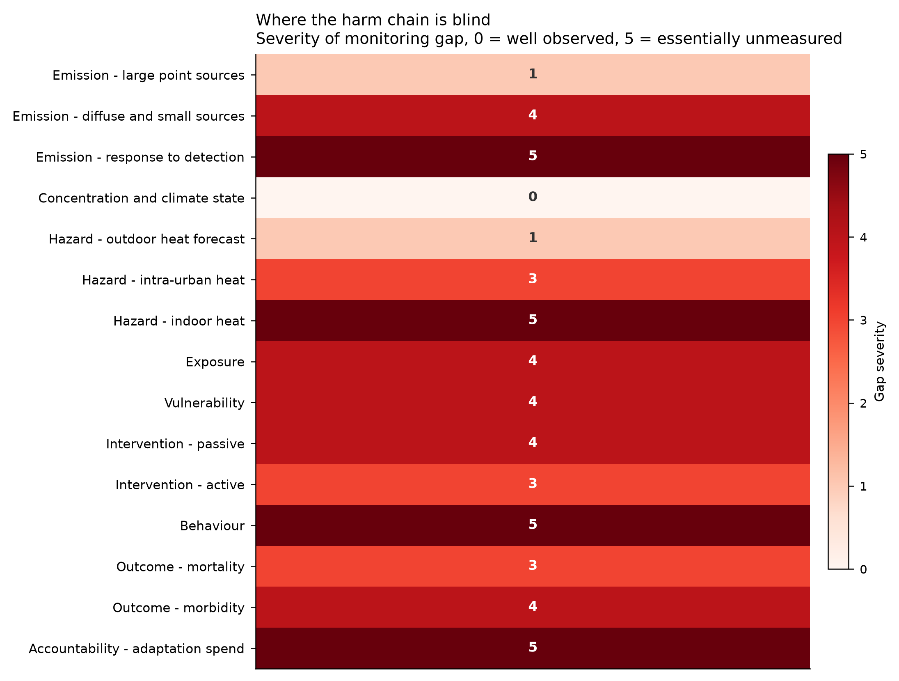

# Digital climate monitoring: what it does, what it misses, and what to build instead

**Scope.** This report inventories the operational digital climate-monitoring landscape, identifies where the observation chain breaks between measurement and action, quantifies the southern-European heat trend from 76 years of reanalysis data, and proposes twelve low-budget interventions that close the highest-severity gaps. None of the proposals requires slowing technology development; one of them is explicitly about running more computation, not less.

---

## 1. The finding in one paragraph

The world has built an extraordinary sensing apparatus for climate and almost no wiring from that apparatus to a response. Of 46 operational monitoring systems inventoried across 8 layers — satellite greenhouse-gas observation, regulatory reporting, grid telemetry, urban sensing, hazard warning, buildings, mobility, and climate finance — 25 publish open data, but only about a dozen are coupled to any actuator that changes a physical outcome without a human deciding to act. Thirty are coupled to nothing at all. The dominant failure is not resolution, latency, or coverage; those have improved by orders of magnitude in a decade. The failure is that detection has no obligated consequence. A methane plume can be resolved to a single wellpad within hours and still not be repaired, because nothing in the chain converts the observation into a repair order. This diagnosis holds across mitigation and adaptation alike, and it is the reason the interventions proposed here are mostly cheap: the sensing is already paid for, the missing piece is institutional plumbing.

---

## 2. What current monitoring does well

Three layers are in genuinely good shape.

**Concentration and climate state.** The global observing system — surface networks, radiosondes, the Copernicus and NOAA satellite constellations, and reanalysis products like ERA5 — measures the state of the atmosphere well enough that this report could quantify 76 years of city-level heat trends for twelve cities in an afternoon, for free, from a public API. This is a genuine public good and it is not the bottleneck for anything.

**Large point-source emissions.** Satellite methane detection has moved from research to operations. Instruments now resolve individual super-emitter plumes, and public attribution of specific events to specific facilities is routine. The detection problem for large sources is substantially solved.

**Outdoor heat forecasting.** National meteorological services in southern Europe issue skillful heatwave forecasts days ahead, and heat-health warning systems exist in essentially every affected country. The forecast is not the weak link.

## 3. Where the chain breaks

The gap matrix (`gap_matrix.csv`, visualised below) walks the causal chain from emission to health outcome and scores how well each stage is observed. Four stages score 5 out of 5 — essentially unmeasured.

**Response to detection (severity 5).** We can see the leak. There is no systematic, public, verified record of whether it was fixed, how long it took, or what the emitter did. Detection systems publish alerts; almost none publish resolution rates. This is the single largest leverage point in mitigation monitoring and it requires no new hardware.

**Indoor heat (severity 5).** Heat kills people indoors, overwhelmingly at night, mostly in bedrooms of elderly people living alone. Not one operational system measures indoor temperature in at-risk dwellings at population scale. Every warning system in Europe is calibrated on outdoor temperature, which is a proxy of unknown and highly variable quality for the temperature of the room where the death occurs. A poorly insulated top-floor flat can hold heat for many hours after the outdoor air has cooled — the warning says the heatwave has broken while the dwelling has not.

**Behaviour (severity 5).** No system measures whether anyone did anything differently after receiving a warning. Heat plan evaluations across Europe consistently find that plans exist and mortality persists, but the evaluations cannot distinguish "the advice was wrong" from "the advice never arrived" from "the advice arrived and could not be followed." Without behavioural measurement, warning systems cannot be improved except by guesswork.

**Adaptation spending accountability (severity 5).** Public money is being spent on cooling, greening, and retrofits with almost no before-and-after measurement at the intervention site. The effect of a tree-planting programme on the exposure of the people who live beside it is typically inferred from literature, not measured locally.

Two further stages score 4: exposure (we know the city's temperature, not the person's) and vulnerability (registers of at-risk residents exist but are rarely linked to live hazard feeds).

---

## 4. The southern-European heat trend, measured

To ground the adaptation case in data rather than assertion, daily maximum and minimum temperatures were pulled from ERA5 reanalysis for twelve southern-European cities over 1950–2025 (333,108 city-days; `heat_trends_annual.csv`). Indicators were computed per city-year and trends estimated by ordinary least squares on year.

**Nights above 20 °C have risen in every city without exception.** Athens averaged 61 such nights per year in 1961–1990 and 83 in 1996–2025. Rome nearly tripled its count (2.8×) and Madrid more than tripled it (3.2×), from a low base.

**Daytime is warming slightly faster than nighttime — and this does not weaken the case for focusing on nights.** Across the twelve cities, summer daily maxima are rising at 0.35 °C per decade against 0.23 °C per decade for minima, with daytime faster in 11 of 12 cities. This contradicts the framing this analysis set out to test, and it is reported as found. The reason night still matters more for policy is distributional, not about rates: night minima sit close to the physiological threshold where the body cannot recover, so a slower warming rate crosses that threshold in far more city-nights than a faster daytime rate crosses 40 °C. Córdoba and Seville now exceed 35 °C on 57 and 50 days a year respectively, but Valletta spends 105 consecutive nights above 20 °C.

**The recovery gap is the sharpest signal.** The longest unbroken run of nights above 20 °C — a direct measure of how many consecutive nights the body gets no chance to shed accumulated heat — has grown in every city. Athens went from 24 consecutive nights to 44. This metric, rather than peak temperature, is the one that maps most directly to the physiology of heat mortality, and no operational warning system in Europe uses it as a trigger.

---

## 5. Proposed interventions

Twelve interventions are specified in `solutions_catalogue.csv`, each with capital cost, running cost, deploying institution, expected effect, evidence strength, and explicit failure modes. They divide into three tiers.

**Household tier — put a sensor where the harm happens.** An indoor heat sentinel (S1) is a sub-30-euro battery sensor in the bedroom of an at-risk resident, reporting indoor night minima, with a threshold crossing triggering an automated welfare call from the municipality rather than a push notification to a phone the resident may not own. The escalation loop is the part that does not currently exist anywhere at scale. Supporting this: a night-ventilation advisory (S3) delivered by SMS telling a household the precise hour to open and close windows, and a shade-first retrofit protocol (S4) that prioritises external solar shading over deep envelope work or air-conditioner subsidies, because external shading blocks gain before it enters the building and costs an order of magnitude less.

**Neighbourhood tier — use infrastructure that already exists.** Smart-meter heat-vulnerability screening (S2) identifies households showing no cooling-load signature during a heatwave using 15-minute interval data that distribution operators already collect; the cost is a data-protection agreement, not hardware. Opportunistic mobile sensing (S6) mounts shielded sensors on buses and municipal waste vehicles, covering more street kilometres per day than any static network a mid-sized city could afford. Cool-route mapping (S5) computes shaded walking routes from free satellite thermal imagery and open building footprints. A cool-refuge network (S10) designates already-air-conditioned public buildings and — critically — places a cheap people-counter at the door so that use is measured and the network can be adjusted.

**Cross-cutting tier — fix the institutional plumbing.** Calibration-as-a-service (S7) offers any citizen or municipal sensor two weeks of co-location at a regional reference station, returning correction coefficients. This is the highest-leverage item in the catalogue: it converts the thousands of low-cost sensors already deployed across Europe from untrusted hobbyist data into usable public data, at roughly four euro-cents per person per year. An open heat-data schema with a municipal API (S8) prevents each city network from becoming a bespoke silo requiring retrospective harmonisation — the model is the ENTSO-E transparency platform, which made European electricity data usable. And instrumenting every adaptation project (S12) mandates that 1–2% of any publicly funded cooling or greening budget goes to before-and-after measurement published to that schema, which is the only way the missing evidence base on cost per unit of exposure reduction ever gets built.

**Carbon-aware scheduling (S11) is the direct answer to the "without stopping technology" constraint.** Deferrable computation — model training, batch jobs — plus EV charging, water heating, and building pre-cooling can be shifted to hours of low grid carbon intensity using free marginal-emissions APIs that already exist. The same mechanism pre-cools buildings during cool early-morning hours, cutting both emissions and heatwave-peak grid demand. Nothing is computed less; the same work is done at a different hour. This is what solving climate impact without slowing technology development actually looks like in practice, and it is one of the few places where monitoring is already wired to an actuator.

### Cost

Nine of the twelve proposals cost under one euro per person per year with capital costs amortised over five years, against roughly 120 euro per person-year for room air-conditioner subsidies and 600 for deep envelope retrofit. The two most expensive proposals — shade-first retrofit at ~44 and the welfare-call roster at ~13 euro per person-year — remain well below the conventional alternatives they partly substitute for.

**These are engineering estimates, not procurement quotes.** They are built from component prices and plausible coverage assumptions, and the coverage denominators (people per sensor, people per city network) carry more uncertainty than the numerators. They are intended to separate items differing by two orders of magnitude, not to rank items differing by 30%.

---

## 6. What would falsify this

The central claim — that the binding constraint is coupling rather than sensing — would be wrong if a well-instrumented city with a mature heat plan showed no residual preventable mortality. Current European evidence points the other way: plans are widespread and excess deaths persist through recent heatwave summers. The second claim, that indoor measurement adds decision-relevant information over outdoor forecasts, is testable directly and cheaply: deploy S1 sensors across a few hundred dwellings, and measure whether indoor night minima predict individual health events better than the outdoor forecast that currently drives warnings. If they do not, the household tier collapses and the cross-cutting tier still stands.

## 7. Priority ordering

1. **Calibration-as-a-service and the open schema (S7, S8).** Cheapest, highest evidence, and they make everything downstream comparable. Nothing else works well without them.
2. **Instrument every adaptation project (S12).** Costs a rounding error on existing budgets and builds the evidence base whose absence forces every other item to be justified from research pilots.
3. **Indoor heat sentinel with escalation (S1) as a measured pilot.** The highest-severity gap, and the one falsifiable claim worth testing first.
4. **Carbon-aware scheduling (S11).** Zero marginal cost, works today, no trade-off against technological progress.
5. **Smart-meter screening and the welfare roster (S2, S9).** Both are data agreements rather than deployments; the lead time is legal, so start early.

---

## Data and methods

Reanalysis: ERA5 daily 2 m maximum and minimum temperature, 1950–2025, twelve cities, via the Open-Meteo archive API. Trends by OLS on annual values. Literature: 8 thematic queries against OpenAlex with per-year publication counts and top-cited works (`literature_corpus.csv`). Inventory: 46 systems compiled from operational documentation, each scored on resolution, latency, openness, funding model, and actuator coupling. Cost estimates are bottom-up from component and labour prices, amortised over five years, and should be treated as order-of-magnitude.

**Caveat on health claims.** This report discusses population-level heat risk and monitoring design. It is not clinical guidance, and decisions about the care of any individual — including anyone identified as at-risk by a system of the kind proposed here — belong with qualified health professionals who have the full context.
